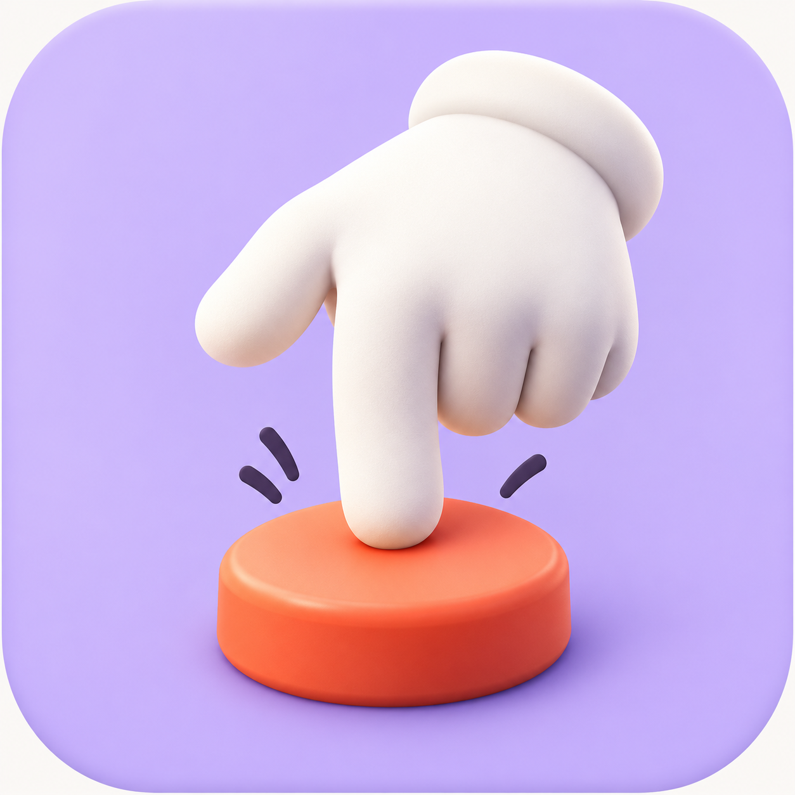
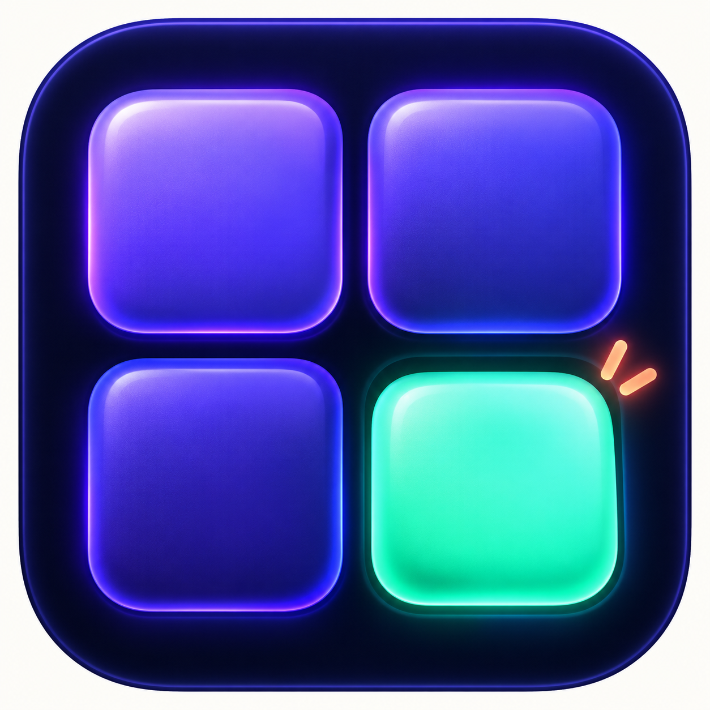
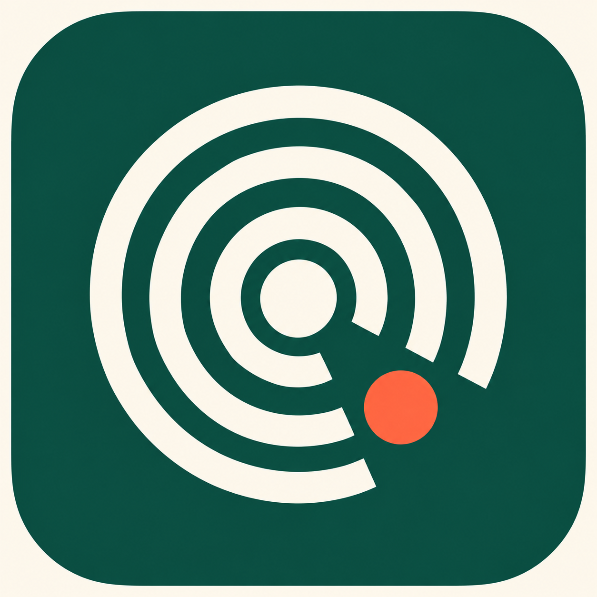
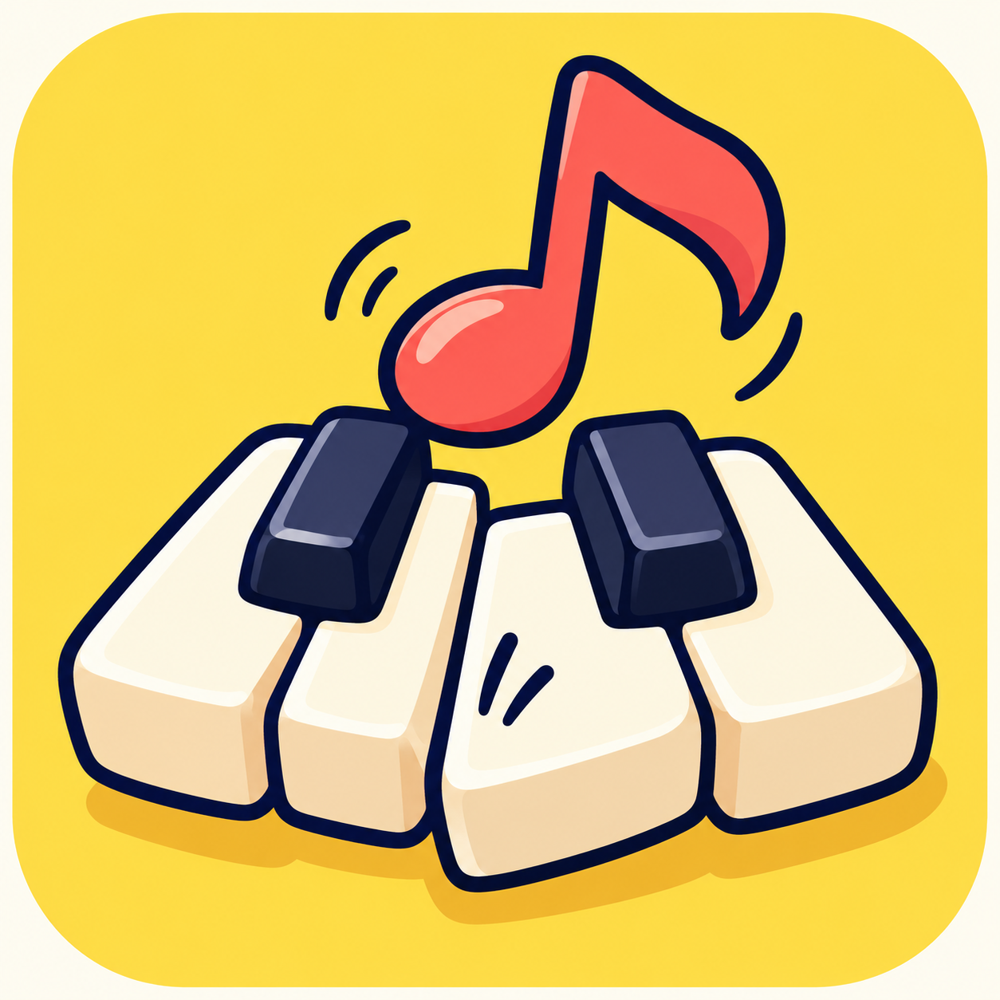
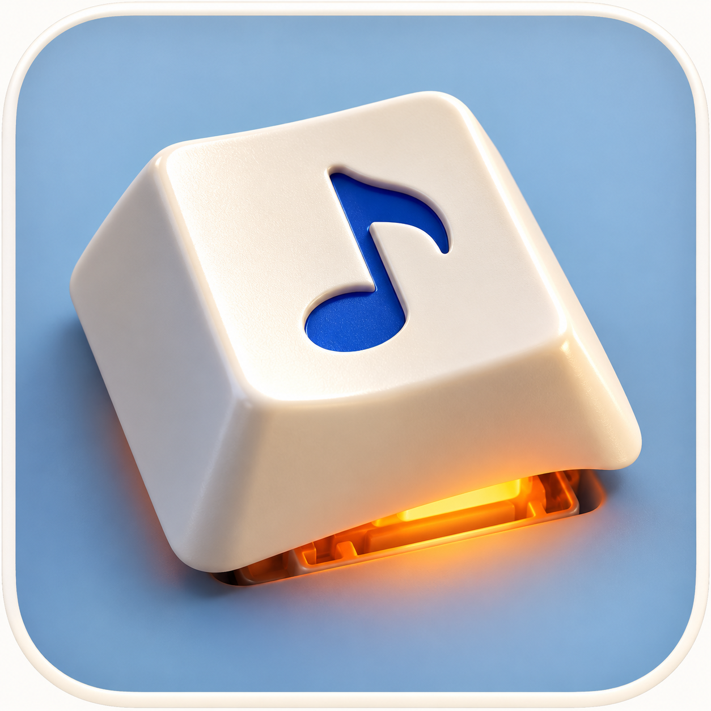
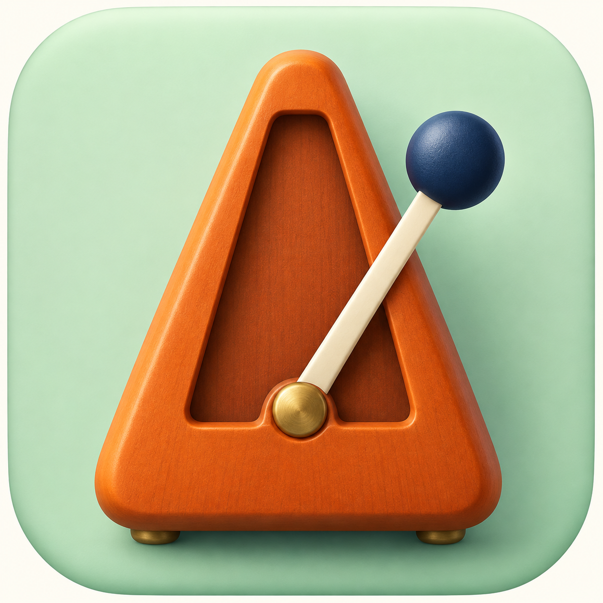
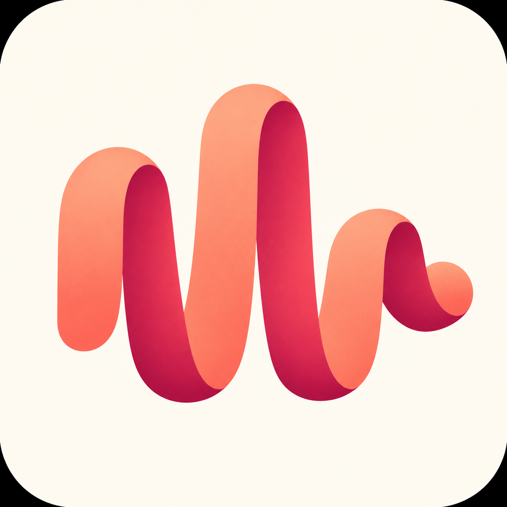

# Tapkit icon concept prompts

Generated with the built-in image_gen tool. Concept review only; the app and landing-page icons have not been changed.

## round-1 (rejected)

### 01-the-tap: The Tap

Use case: logo-brand. Create ONE square macOS app icon concept for Tapkit, a playful app for tapping on your keyboard to play little floating instruments alongside your music. Concept 1: THE TAP. A single sculptural white cartoon glove with exactly five anatomically sensible digits, index finger pointing down and touching a single raised round coral-orange drum pad. Other fingers curled compactly, no long spindly finger. Two small restrained curved contact strokes communicate a rhythmic tap. Large friendly iconic silhouette. Premium tactile toy-like 3D, smooth matte materials, subtle self-shadow, not photoreal skin. Background is a solid warm pale lavender rounded square that fills the whole square canvas, with soft macOS-style corner rounding and a tiny ivory outer margin. Coral pad, creamy white glove, muted dark ink contact strokes. Straight-on slightly elevated view, central composition, broad breathing room, readable at 64px and 32px. It must feel like an actual app icon, no mockup device, no surrounding scene, no typography, no letters, no watermarks, no extra icons, no star or asterisk. Output square.

### 02-beat-pads: Beat Pads

Use case: logo-brand. Create ONE square macOS app icon concept for Tapkit, a little desktop app where people tap keys to play instruments along with music. Concept 2: BEAT PADS. A bold simple 2 by 2 set of four generous soft square performance pads, arranged in a tight precise grid, filling the center of a deep midnight navy rounded-square app icon. Three pads are subdued indigo/violet and one lower-right pad is bright electric mint with a tiny warm coral contact spark made from two short simple rays. One pad looks gently pressed down. Hardware-inspired tactile glossy silicone, carefully controlled neon rim illumination, soft bevels, a premium minimal electronic musical toy. No knobs, no lettering, no clutter, only four pads. Icon has strong dark silhouette, high contrast with one vivid active beat, legible at very small sizes. Straight-on view, no isometric perspective, large center motif with adequate padding. Rounded square fills nearly the full square image, tiny neutral ivory margin outside. No device mockups, no extra scene, no text, no logos, no asterisks. Output square.

### 03-ripple: Ripple

Use case: logo-brand. Create ONE square macOS app icon concept for Tapkit, a playful app for tapping instruments in time with whatever music is playing. Concept 3: RIPPLE. A distinctive flat geometric graphic mark representing a fingertip striking a beat and sound rippling outward: three thick concentric broken ivory circular bands, with their coordinated gap opening toward the lower right, and a single vivid coral-orange circular beat dot sitting in that gap just outside the central disc. A strong custom-designed abstract rhythm logo, balanced yet slightly syncopated, simple enough to recognize at 16px. The central disc and circle spacing should be generous, no thin lines. Forest-teal rounded square background, warm creamy white bands, bright coral dot. Sophisticated editorial Swiss-style flat graphic design, clean crisp vector-like edges, absolutely no 3D or gradients or texture. The rounded-square icon fills almost the whole square canvas with a tiny warm ivory outer margin. Centered composition with safe padding, memorable silhouette. No text, no numbers, no letters, no music notes, no waveforms, no star/asterisk, no mockup scene. Output square.

### 04-pocket-keys: Pocket Keys

Use case: logo-brand. Create ONE square macOS app icon concept for Tapkit, a fun app that turns keyboard taps into music played on little floating instruments. Concept 4: POCKET KEYS. A delightfully bold cartoon emblem of three chunky miniature ivory piano keys and two short black keys, one white key bouncing slightly lower from a tap, with ONE large coral-red musical eighth note springing upward behind them. The musical note is a prominent simple classic music-note silhouette, playful curved stem, no face. Bold dark navy ink outlines, confident limited colors, subtle offset cartoon cel shadow, flat illustrated sticker-like finish, not a 3D render. The instrument keys are an intentionally simplified compact symbol, no whole piano case, no extra instruments. Butter-yellow rounded-square background. Warm cream keys, dark navy black keys, coral note. Strong visual hierarchy, a recognizable musical app icon at small sizes, humorous and charming but polished. Nearly full-canvas rounded square with tiny ivory outer margin and adequate inner padding. No words, no letters on the keys, no labels, no watermarks, no extra notes, no asterisk, no device mockups. Output square.

## round-2

### 05-tapkit-monogram: Tapkit Monogram

Use case: logo-brand. Create ONE original square app-icon design concept for Tapkit, a playful Mac app where keyboard taps play floating musical instruments along with your music. New direction: a bespoke lowercase t symbol that doubles as a musical percussion mark. Design a thick sculptural lowercase t, with a generous short crossbar, softly squared edges and a stem ending in a rounded off-center beat head. The t should feel custom drawn, slightly jaunty, confident, and incredibly memorable. One tiny separated accent dash at the upper right suggests the next beat. Very bold ivory symbol on a richly saturated vermilion-orange rounded-square tile. Refined flat graphic design, geometric optical balance, exceptionally crisp clean edges, no dimensional effects, no decorative texture. Fill the square canvas with the rounded-square tile and a very narrow warm-white margin. Center the symbol with about 20 percent safe padding. Communicate rhythm through its asymmetry. No piano, no hand, no pads, no circular ripples, no extra lettering or text, no wordmark, no app mockup, no shadows. This should feel like a strong independent brand, not a stock music pictogram. Output square.

### 06-one-key: One Key

Use case: stylized-concept. ONE square macOS app icon for Tapkit, which lets users play along with music by pressing ordinary computer keyboard keys. Concept: ONE KEY. A single oversized beautiful mechanical-computer-keyboard keycap, creamy porcelain white with a small beautifully recessed cobalt-blue musical eighth-note glyph in its top surface. The keycap is visibly being pressed down at one corner, with a vibrant orange underglow peeking from the key switch beneath. No hand, no finger, no character. Orthographic three-quarter view, large single object, very restrained warm studio lighting. Background is a muted powder-blue rounded square. Thick friendly proportions, polished handcrafted desktop toy, tactile premium 3D app-icon finish. Visually quiet, lots of clean breathing room, elegant material contrast, great silhouette at 32px. The keyboard keycap is the only object; no piano keys, no keyboard grid, no circle rings, no text, no letters, no asterisk, no surrounding scenery, no device mockup. Nearly full-canvas rounded-square tile with a narrow warm-white edge. Output square.

### 07-swing: Swing

Use case: stylized-concept. Create ONE polished square macOS app icon concept for Tapkit, an app about joining the beat and tapping along to music. Concept: SWING. A delightful tiny iconic mechanical metronome, simplified into a compact triangular burnt-orange wooden case, a single slender cream pendulum arm swung boldly to the right, and one large round dark-blue pendulum weight. The pendulum's diagonal breaks the otherwise symmetric silhouette. It should convey rhythm at a glance without using soundwave rings or musical note symbols. Softly rounded corners and exaggerated playful toy proportions, high-end tactile matte 3D rendering, subtle inset opening and one brass base detail, no numbers or scale marks or knobs. Calm pale mint-green rounded-square backdrop, warm orange case, cream arm, navy weight. Straight-on view from slightly above, central framing, about 17 percent breathing room, readable at small app-icon sizes. A single compelling object with personality, no hands, no piano, no pad grid, no other instruments, no text, no lettering, no asterisk, no surrounding scene or device mockup. Fill almost all the square image with the rounded-square icon tile, tiny ivory outside margin. Output square.

### 08-groove-ribbon: Groove

Use case: logo-brand. Create ONE distinctive square app-icon concept for Tapkit, a playful music app for tapping along to the beat. Concept: GROOVE. A single thick continuous ribbon symbol forming three rhythmic vertical bends, like a compact syncopated audio waveform frozen mid-bounce. Broad rounded peaks of deliberately unequal heights: medium, tall, short. The same continuous band curls forward at the short right end to imply movement. This is a custom elastic sculptural symbol, NOT a line-chart equalizer or a stock sine wave. The ribbon is warm peach/coral on one side, deep raspberry on the folds, giving a beautiful restrained folded-paper depth. Very simple silhouette and strong negative spaces. Creamy ivory rounded-square tile. Bold contemporary Scandinavian editorial identity, playful and premium, mostly flat graphic design with just enough folded-shape shading to explain the continuous ribbon; no glossy 3D rendering. Tight centered composition with 18 percent safe padding, legible at 32px. No hands, no piano, no pads, no circular rings, no music note glyphs, no letters, no text, no asterisk, no mockup scene. Rounded-square tile nearly fills the whole square canvas with tiny outside margin. Output square.

