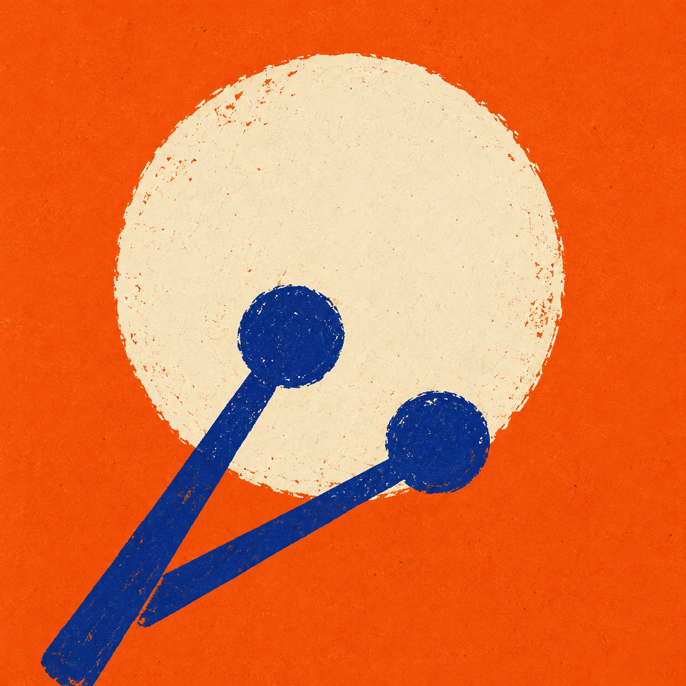
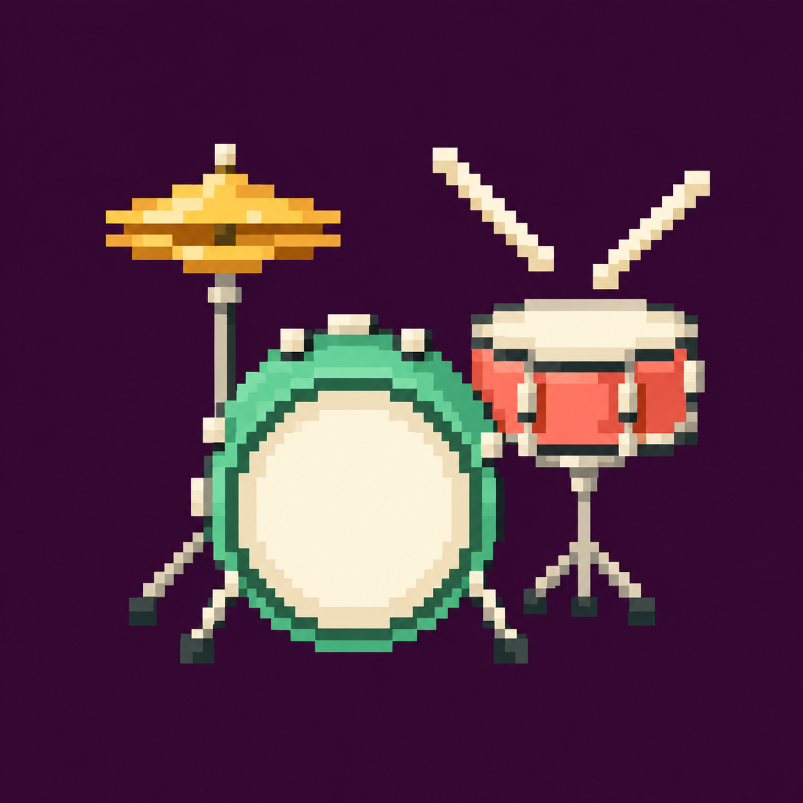
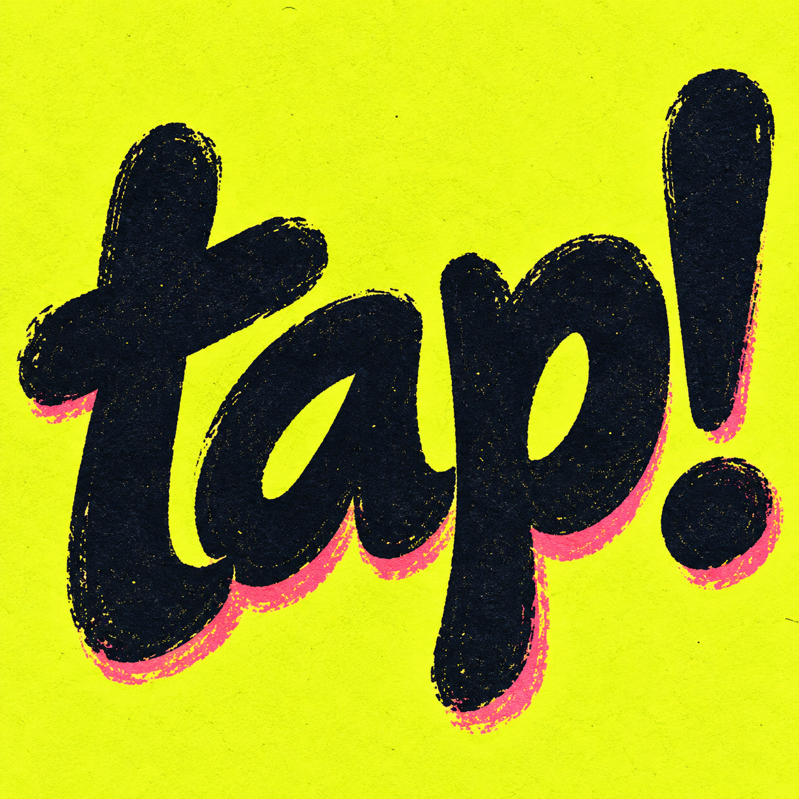
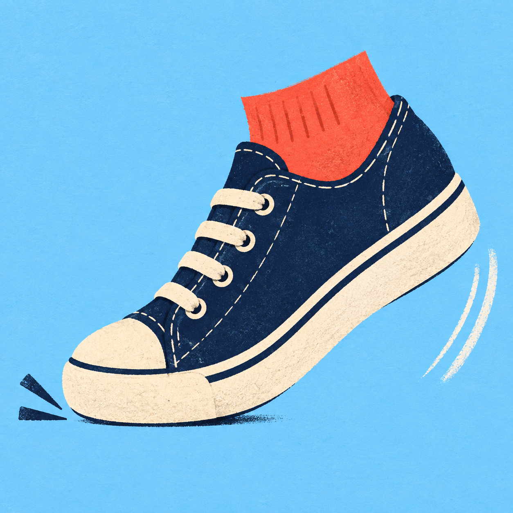
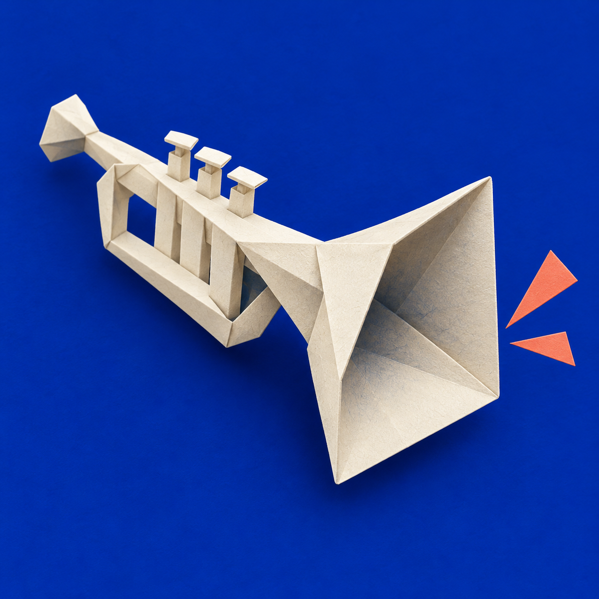

# Tapkit icon concepts — round 3

Five new square concepts generated with the built-in image_gen tool on 27 October 2026. App and landing-page icons remain unchanged pending selection.

## 09-afterbeat: Afterbeat

Use case: logo-brand. Produce one square icon concept for Tapkit, a music app for tapping along to the music you are listening to. Visual direction: a bold 1960s experimental jazz sleeve designed as a tiny emblem. A single rough-edged cream drumhead disc sits slightly above center; two dark cobalt percussion sticks, each a thick short shaft with a rounded mallet tip, cross its lower edge at energetic unequal angles, suggesting a beat being struck. Highly intentional asymmetric composition, just three main shapes. Burnt tangerine full-bleed square background, warm ivory drumhead, deep cobalt sticks. Authentic risograph / hand-cut linocut print aesthetic: broad flat ink fields, restrained grain, tiny print registration imperfections. The shapes must be large and graphic, confidently readable at small sizes. This is sophisticated record-sleeve artwork distilled into a square symbol, NOT a plastic 3D icon render. No rounded-square tile border, no inset frame, no mockup device, no shadows, no typography, no text, no hands, no pads, no keyboards, no concentric rings, no extra instruments. Output a perfectly square canvas.

## 10-pocket-percussion: Pocket Percussion

Use case: illustration-story. Create one square app-icon concept for Tapkit, a little app that lets people join the beat with on-screen instruments. A tiny joyful pixel-art drum kit: one large mint-green bass drum with an ivory circular head, one coral snare, and one simple golden hi-hat. Two short white pixel drumsticks hover above the snare at clear opposing diagonals. No person and no hands. Compose the small drum kit as ONE compact instantly readable sprite, large in the center with adequate breathing room. Distinctive professional 16-bit pixel art, a limited palette of warm ivory, mint, coral and ochre against a full-bleed deep aubergine square background. Visible deliberate chunky square pixels, consistent pixel grid, no smooth curves or antialiasing, no fine intricate hardware, no labels or text. Charming and rhythmic, like a treasured little desktop game. No rounded app-tile frame, no glossy rendering, no gradients, no screenshots, no surrounding scene, no platform or floor. Output one perfectly square standalone icon.

## 11-tap-type: Tap!

Use case: logo-brand. Create one square icon concept for Tapkit, an app for tapping musical instruments along with the songs you love. Entirely typographic direction: the exact word 'tap!' as huge original hand-lettered ink artwork. The letters are rounded, thick, energetic and slightly irregular, with lively compact stacking and a gently rising baseline so the word itself feels rhythmically struck. Lowercase t a p followed by an exclamation mark, legible as 'tap!', no other letters. The p descender and exclamation dot balance the lower area of the square. Deep black-blue brush ink on acid chartreuse-yellow full-bleed square paper, one small warm pink offset overprint at the base of the lettering, subtly visible imperfect ink edges and letterpress texture. Art-directed contemporary music festival identity, confident typographic illustration, expressive but controlled, mostly two colors. Fill about 75 percent of the canvas with the custom lettering, wide bold shapes legible at small sizes. No standard typeset font, no separate musical-note glyph, no monogram t alone, no hands, no keycaps, no pads, no metronome, no waveforms. No 3D, no bevels, no shadows, no rounded-square border or mockup. Output a perfectly square graphic.

## 12-footwork: Footwork

Use case: illustration-story. Design one square music-app icon concept for Tapkit, an app about the irresistible urge to tap along to a song. A single expressive sneaker-clad foot tapping to the beat: navy-blue low-top canvas sneaker with a chunky warm ivory rubber sole, toe touching down and heel raised, small cropped coral-red sock visible at the top. Clear side profile tilted slightly toe-down. Two short decisive ink contact marks beneath the toe and one ghosted hand-drawn heel motion arc communicate rhythmic foot tapping. No full person, no hand. Beautiful pared-back 1950s editorial spot illustration: bold hand-cut shapes, slightly imperfect ink outlines, subtle printed paper texture, playful movement, tasteful flat colors, absolutely no realistic 3D rendering. Full-bleed pale sky-blue square background. The sneaker occupies about 70 percent of the image, one clean readable silhouette at small sizes, joyful music-listening body language. No text, no logos on the shoe, no labels, no musical-note glyph, no circles, no detailed laces, no decorative clutter, no rounded-square app tile border, no device mockup. Output one perfectly square icon.

## 13-paper-jam: Paper Jam

Use case: stylized-concept. Create one square icon concept for Tapkit, a playful app with little on-screen musical instruments. Radical paper-craft direction: one striking miniature origami trumpet made entirely from crisp ivory paper, composed of just a few confident angular folds. A broad open flared square bell faces the viewer slightly to the right; the folded narrow trumpet body sweeps diagonally back toward upper left. The folded paper silhouette must still clearly read as a tiny musical horn, not a megaphone or bird. Only one or two small abstract coral paper wedges near the bell imply a little burst of sound. Deep saturated ultramarine full-bleed square backdrop, creamy white paper with graphite-blue shadows strictly inside its folds, one restrained coral accent. High-end editorial paper sculpture, visible fine paper fibers, tactile crease shadows, spacious bold composition. This should look like photographed folded paper, never glossy plastic, no chrome, no wood, no musical note glyph, no hand, no lettering, no ribbon or waveform shape, no extra instruments. Single strong emblem suitable for a small app icon, no pedestal or floor, no external cast shadow, no rounded-square frame, no mockup device, no text. Output one perfectly square image.

