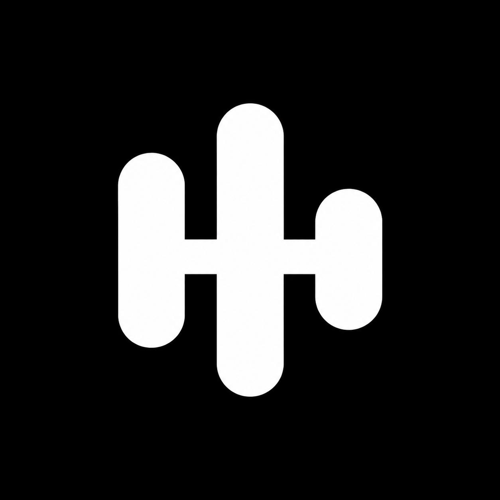

# Tapkit icon concepts — round 4

Generated with the built-in image_gen tool on 27 October 2026. Four minimal monochrome sound/music marks. Each concept has a square black field for the app icon; the inner mark is intended for a transparent menu-bar template after selection and vector refinement. No production icons have been replaced.

## 14-note: Note

Use case: logo-brand. Create ONE extremely minimal monochrome logo concept for Tapkit, an app for playing little instruments along with music by tapping keyboard keys. The very same central mark must also work alone as a macOS menu-bar template icon at 16–20 pixels. Presentation: a pure WHITE symbol centered on a pure BLACK perfectly square canvas, occupying about 60 percent of the canvas, with generous even padding. Use only solid black and solid white, crisp vector-like contours, no shading, no texture, no gradients, no 3D, no lighting, no shadows, no frames, no inset tile, no other symbols, no labels, no typography, no mockups or additional miniature examples. Design one strong unified symbol with thick strokes and generous negative space, extremely simple geometry, visually balanced and recognizable when tiny. It must feel like a professionally drawn functional icon, not an illustration. Concept: NOTE. A single compact musical eighth note as one continuous white silhouette. One generous slightly tilted oval notehead, one short sturdy upright stem, and one simple curved flag at the top. The flag is broad and reduced to one clean gesture, with a wide black opening between it and the stem. Optical balance and rounded terminals, disciplined proportions. No paired notes, no motion marks, no added circle or line. The silhouette itself should communicate music immediately and remain clear at menu-bar scale.

## 15-pulse: Pulse

Use case: logo-brand. Create ONE extremely minimal monochrome logo concept for Tapkit, an app for playing little instruments along with music by tapping keyboard keys. The very same central mark must also work alone as a macOS menu-bar template icon at 16–20 pixels. Presentation: a pure WHITE symbol centered on a pure BLACK perfectly square canvas, occupying about 60 percent of the canvas, with generous even padding. Use only solid black and solid white, crisp vector-like contours, no shading, no texture, no gradients, no 3D, no lighting, no shadows, no frames, no inset tile, no other symbols, no labels, no typography, no mockups or additional miniature examples. Design one strong unified symbol with thick strokes and generous negative space, extremely simple geometry, visually balanced and recognizable when tiny. It must feel like a professionally drawn functional icon, not an illustration. Concept: PULSE. A compact audio waveform formed from exactly three thick upright rounded bars of different heights, joined through their midpoints by a thick short horizontal bridge, making ONE connected silhouette. Medium-height bar on the left, tallest bar in the middle, shortest bar on the right. Each bar extends both above and below the connecting centerline, like a very reduced digital sound signal. Rounded capsule ends, uniform stroke weight, wide clear black notches. Width and height roughly equal. No detached dots, no more than three bars, no circular shapes, no musical-note glyph. Keep the design exceptionally spare.

## 16-fork: Fork

Use case: logo-brand. Create ONE extremely minimal monochrome logo concept for Tapkit, an app for playing little instruments along with music by tapping keyboard keys. The very same central mark must also work alone as a macOS menu-bar template icon at 16–20 pixels. Presentation: a pure WHITE symbol centered on a pure BLACK perfectly square canvas, occupying about 60 percent of the canvas, with generous even padding. Use only solid black and solid white, crisp vector-like contours, no shading, no texture, no gradients, no 3D, no lighting, no shadows, no frames, no inset tile, no other symbols, no labels, no typography, no mockups or additional miniature examples. Design one strong unified symbol with thick strokes and generous negative space, extremely simple geometry, visually balanced and recognizable when tiny. It must feel like a professionally drawn functional icon, not an illustration. Concept: FORK. A beautifully simplified tuning fork as ONE continuous white silhouette. Two sturdy parallel upright prongs, rounded ends, a smooth deep U-shaped connection at the bottom of the prongs, and a short centered stem extending downward from the U. The interior black gap stays completely open at the top and generously wide. Slightly softened geometry, strong compact proportions, medium-wide shape rather than a tall spindly utensil. No vibrating lines, no surrounding sound waves, no dots, no base or handle decoration. The absolute minimum needed to recognize an elegant tuning fork.

## 17-wave: Wave

Use case: logo-brand. Create ONE extremely minimal monochrome logo concept for Tapkit, an app for playing little instruments along with music by tapping keyboard keys. The very same central mark must also work alone as a macOS menu-bar template icon at 16–20 pixels. Presentation: a pure WHITE symbol centered on a pure BLACK perfectly square canvas, occupying about 60 percent of the canvas, with generous even padding. Use only solid black and solid white, crisp vector-like contours, no shading, no texture, no gradients, no 3D, no lighting, no shadows, no frames, no inset tile, no other symbols, no labels, no typography, no mockups or additional miniature examples. Design one strong unified symbol with thick strokes and generous negative space, extremely simple geometry, visually balanced and recognizable when tiny. It must feel like a professionally drawn functional icon, not an illustration. Concept: WAVE. ONE thick continuous fluid sound-wave stroke: a short horizontal entrance curves into one rounded upward peak, descends into one rounded trough, and returns to a short horizontal exit. A minimal analog audio waveform with precisely ONE peak and ONE trough, like a confidently drawn sideways S lying across the square. Round caps, completely uniform bold stroke, beautifully controlled curved transitions, no sharp ECG corners. Width about one-and-a-half times its height. No extra wave repeats, no detached bars, no dots, no circles, no musical notes, no decoration. It must work as one clean sound-based brand mark at very small scale.

